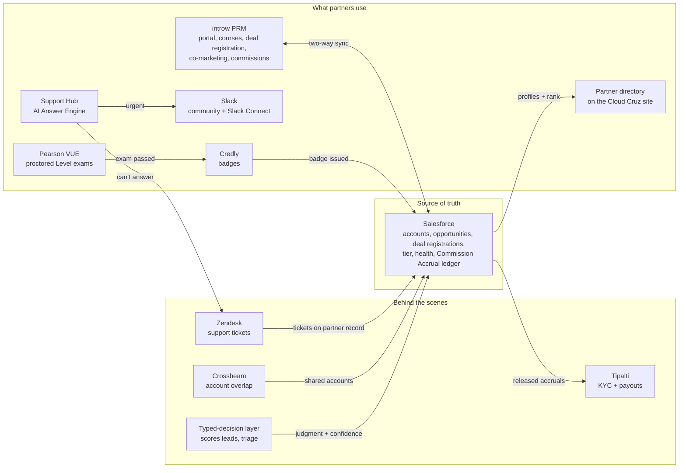

# 07 Systems

**Salesforce is the one source of truth. Partners work in introw, money moves through Tipalti, and every other tool writes its result back to the partner record. A flat team of 9 reads one scorecard instead of eight dashboards.** (Decisions 16 to 24, 69, 70, 82 to 84)

> All of this is synthetic. Cloud Cruz and its partners are invented.

## The map

## What each system owns

| System | Owns | Writes to Salesforce | Decision |
|---|---|---|---|
| **Salesforce** | Partner and customer accounts, opportunities, deal registrations, tier, health, credentials, the Commission Accrual ledger | (it is the record) | 24 |
| **introw** (PRM) | The partner portal: onboarding checklist, courses and study, accreditations, deal registration, co-marketing requests, community, contribution points, commission calculation | Two-way sync: deal registrations, onboarding progress, accreditations, approved points, calculated commissions | 20, 82, 83 |
| **Tipalti** | Partner KYC, payout details, payments | Payment status on each released accrual | 21 |
| **Pearson VUE** | Proctored Level 1, 2 and 3 exams and the exam vouchers | Pass or fail, through the Credly badge | 83 |
| **Credly** (Certifier in the demo) | Badges, issued when an exam or accreditation is passed | Credential, level, issue and expiry dates | 22, 27, 83 |
| **Crossbeam** | Account overlap between Cloud Cruz and each partner | Shared target accounts, used in co-sell and the onboarding health check | 23 |
| **Slack** | Partner comms: one community workspace for everyone, plus a Slack Connect channel per design partner in the beta and per Premier and Elite partner after launch | Nothing: comms never count as activity | 17, 84 |
| **Zendesk** | Partner support tickets | Tickets on the partner record, feeding "Is their delivery clean?" | 18 |
| **Support Hub** | Version-controlled program docs, answered with citations by the AI Answer Engine (build 4) | Through Zendesk when it can't answer | 19 |
| **Partner directory** | A public page on the Cloud Cruz site where customers find a partner, built from each partner's profile in Salesforce and ranked by contribution points and results | Reads only | 51, 78, 82 |
| **Typed-decision layer** (Jev first) | Judgments plain code can't make: lead signals now, support routing and deal triage later | Every judgment with its value, confidence, model and date | 69, 70 |

## How money moves

1. The customer pays an invoice, and it closes.
2. introw calculates the commission at the rate locked at close (decision 73).
3. Salesforce records a Commission Accrual: **Earned**, then **Held** for 60 days, then **Released** (decisions 21, 24).
4. Tipalti pays the released amount and records the payment.
5. A refund within 90 days reverses the accrual (decision 75).
6. Finance books the accrual in the ERP.

Co-marketing campaigns follow the same path. The partner requests in introw, Cloud Cruz approves the plan, and Tipalti pays once there's proof of performance (decision 77).

## Rules that keep it simple

- **One record per fact.** A number lives in one system and is copied, never re-typed. Tier, health and the scorecard are computed in Salesforce, so partners and Cloud Cruz see the same numbers (decision 33).
- **Events, not polling.** A paid invoice, a badge or a new ticket fires an update. Batch work runs on a schedule. A score written twice gives the same answer (decision 70).
- **A person approves anything that changes state.** Every AI send in Year 1, every payout release and every tier change is approved by a person (decision 71).
- **Every AI judgment is logged and has a fallback.** If the typed-decision layer is down, plain rules take over, and low-confidence calls go to a person (decision 69).
- **No tool without an owner.** Partner operations owns the Salesforce and introw configuration. Every other tool has a named admin in 10 Roles.

## The demo stack

The public demos run on the same design with synthetic data. Supabase (Postgres) stands in for the warehouse. Claude answers questions and writes SQL through a read-only role, with a 5-second timeout and a 500-row cap. The site runs on Vercel. A Salesforce developer org shows the setup with a 50-partner sample (08 Salesforce setup). introw's free plan shows one design partner end to end (decision 20).

## Why this saves time and money

Each tool does one job and writes its result to one place, so no one reconciles spreadsheets or chases a number across systems. Partners get one portal. The team gets one scorecard. Cloud Cruz pays only for tools that carry work a flat team would otherwise do by hand.
