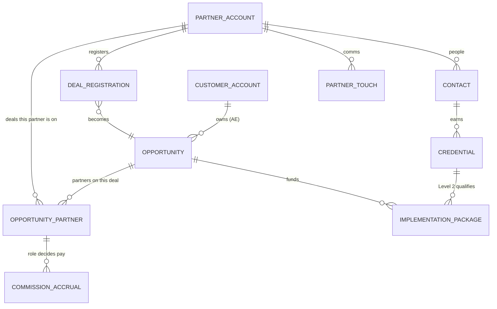
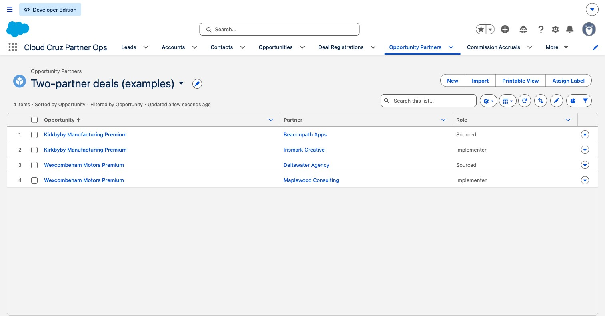
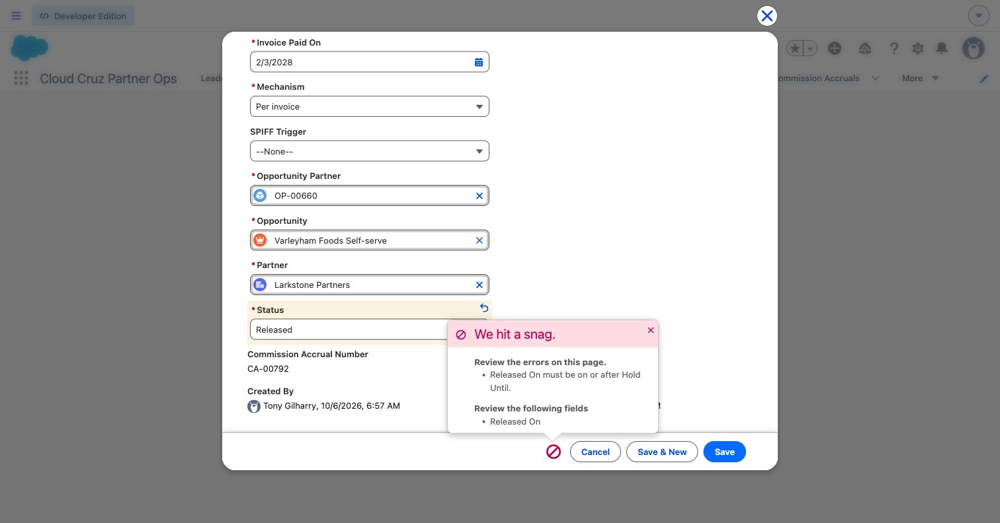
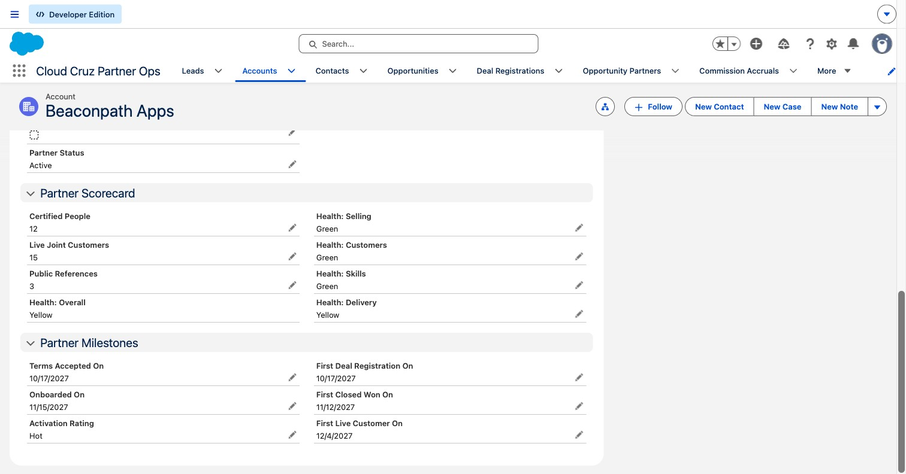
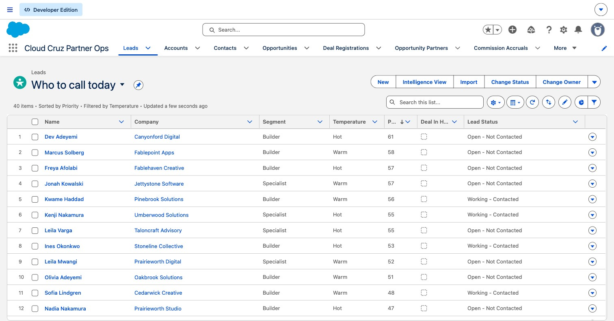
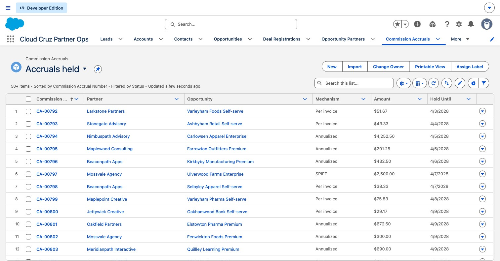
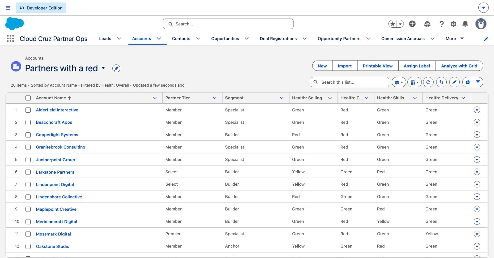

# 08 How I set up Salesforce for this

**Partners work in introw; Salesforce is the record. I set it up so the program's rules are enforced by the system, not by anyone's memory: a commission can't be released early, a package can't go to a deal without a Level 2 person, and a deal can carry two partners without anyone arguing about credit.** (Decisions 24, 62, 85, 91 to 94)

> All of this is synthetic. Cloud Cruz, its partners, customers and people are invented. The org is a free Developer Edition, and every object, field and rule is code in [`salesforce/`](salesforce/).

## The model in one picture



| Object | What it holds | Why it exists |
|---|---|---|
| **Account** (Partner and Customer record types) | Partners and customers in one object, so they report together | Customer records stay standard Salesforce |
| **Opportunity** | Every deal, always on the **customer** account, owned by the AE | The AE owns the customer; the partner attaches (decision 50) |
| **Opportunity Partner** | One row per partner per deal, with a role: Sourced, Influenced, Implementer, Partner of record | Real deals have more than one partner (decision 85) |
| **Deal Registration** | The partner's claim, answered in 2 business days | Protection and the SLA (decision 79) |
| **Commission Accrual** | Earned, Held 60 days, Released, or Reversed | The ledger Tipalti pays from (decisions 21, 24) |
| **Implementation Package** | Funded hours on an Enterprise deal | Pays for work, not claims (decisions 61, 94) |
| **Credential** | One badge per person, with expiry and last product use | Certified people count toward tier (decision 47) |
| **Partner Touch** | Slack, introw and email touches | Context only; never counted as activity |
| **Lead** | Stage 0 partner leads, with fit, intent and the typed judgment | Who to call today (decisions 35, 68 to 70) |

## "Where are the customer records, and how does a deal flow?"

Customers are standard Accounts with a Customer record type; their people are Contacts. The opportunity always lives on the customer account, owned by the AE. The partner attaches to it, never the other way round.

1. **The partner registers the deal** in introw. It syncs as a **Deal Registration**, linked to the partner and the customer account, due in 2 business days.
2. **The partner account manager approves it.** That protects the partner for 90 days. When the AE opens the **Opportunity on the customer account**, it's marked *Sourced* with the sourcing partner set. The AE keeps full quota credit.
3. **Co-sell.** The deal moves through normal stages; another partner can join as Influenced.
4. **Closed won, invoice paid.** A **Commission Accrual** is created on that deal and that partner's role: Held 60 days, then Released to Tipalti.
5. **The customer goes live.** The partner's "first live customer" milestone is set, and the deal counts toward the north star, customers live through partners.

Any commission dollar traces back to a role, a deal and a customer.

## Two partners on one deal



One partner sources, another implements. Each role is its own row, so credit, commission and the implementation package each follow the role, not the deal. Salesforce's standard Opportunity Partner list can't hold custom fields, which is why partner teams usually build this junction themselves.

## Rules the system enforces

Every program decision that can be checked is a validation rule. A bad record isn't caught later in a spreadsheet; it can't be saved.



| Rule | Decision |
|---|---|
| A commission can't be released before its 60-day hold ends | 21 |
| Only a Sourced or Partner of record partner earns commission; influence earns no cash | 74, 94 |
| The accrual's role row must be this partner on this deal | 85 |
| A SPIFF names its trigger, and only a SPIFF has one | 76, 88 |
| A package needs an active Level 2 or 3 technical credential on its approval date; only beta packages can use the PSA stand-in | 53, 91 |
| Packages are for Enterprise deals of $50K ACV or more, at no more than $150 and $200 an hour | 45, 61 |
| Levels expire after 12 months; accreditations never do | 47, 80 |
| A sourced deal names the partner that is paid, and the Sourced row must match it | 85 |
| A rejected registration states why; an expired one has no opportunity | 79 |
| A lead with a deal in hand is always Urgent | 35 |
| Elite needs an invitation | 32 |

A rolled-back smoke test tries every rule on throwaway records: 24 of 24 pass, and nothing stays in the org (`salesforce/scripts/smoke-test.apex`).

## The partner record: one scorecard



The partner sees the same numbers Cloud Cruz sees (decision 33): segment, tier, lifecycle stage, the counts tiers are built on, contribution points, the four health questions (decision 54) and the activation milestones (decision 43).

Tiers come from these counts, checked on the 1st of each month (decision 92), so a partner can see exactly what the next tier takes.

## The views the team works from







- **Who to call today** sorts open partner leads by fit times intent (decision 70).
- **Accruals held** is finance's view of what releases when.
- **Partners with a red** is the partner managers' list: anyone with a red on selling, customers, skills or delivery.
- **Deal registrations overdue** catches anything past its 2-business-day SLA.

## What building it taught me

Loading real program data into the rules exposed three that were wrong, and I fixed them:

1. **The Level 2 check compared against today's date.** Historic packages failed once a credential expired later. It now checks the approval date.
2. **"Approved needs an opportunity" contradicted the program.** An approved registration protects the partner for 90 days before any opportunity exists. The rule now checks the opposite case: an expired registration can't have an opportunity.
3. **Deal Source had an "Influenced" value.** Influence is a role on the deal, not a source. Source is now Sourced, Direct or Marketplace.

One more change came later. **Date formulas compared against the real today.** "Counts Toward Tier" (used in the last 90 days) and "SLA Missed" drifted a little more each day the sample sat still. They now compare against one setting, **Program as-of date** (custom metadata, set to Mar 31, 2028), so the org always describes the program on its own calendar (decision 102).

## The sample

The 25 beta design partners plus 25 launch partners across the four segments (decision 62), with their customers, deals, roles, registrations, people, credentials, accruals, packages and recent touches, plus the 40 open leads at the top of Who to call today: **2,088 records**. They are exported from the same seeded generator as the database, so the org and the data agree, and loaded with one command. Each partner's slice is capped to fit Developer Edition's 5 MB of storage (about 4 MB used). Salesforce's default demo records were removed first, so every record in the org is Cloud Cruz's.

```
sf project deploy start --target-org cloud-cruz                       # the metadata
node blueprint/salesforce/scripts/export-sample.ts                    # the sample (from the repo root)
sf data import tree --plan blueprint/salesforce/data/plan.json --target-org cloud-cruz
sf apex run --target-org cloud-cruz --file blueprint/salesforce/scripts/smoke-test.apex
```

## Why this saves time and money

The rules that cost money when they slip (early payouts, packages on unqualified deals, commission on influence) are enforced at save, so nobody audits for them later. Partners, AEs and finance read one record instead of reconciling three systems. And because the setup is code, the next org is one deploy, not a week of clicking.
